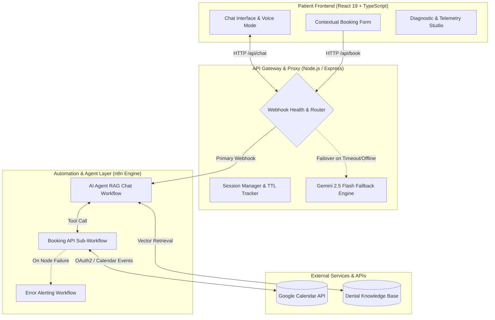

# 🦷 Denttora Dental Clinic — Autonomous AI Patient Receptionist & Calendar Booking Engine

[](https://www.typescriptlang.org/)
[](https://react.dev/)
[](https://nodejs.org/)
[](https://n8n.io/)
[](https://ai.google.dev/)
[](https://developers.google.com/calendar)

> **Enterprise-grade, multi-agent AI patient receptionist and automated calendar scheduling system.** Engineered with React 19, TypeScript, an Express proxy gateway, Google Gemini, and n8n workflow automation synchronized directly with Google Calendar API.

---

## 📌 Executive Summary & Problem Solved

### The Problem
Dental clinics and healthcare practices face significant operational bottlenecks:
- **Missed Revenue & Patient Churn:** Over 35% of prospective patient inquiries occur outside clinic operating hours (evenings and weekends), leading to lost bookings when no receptionist is available.
- **Reception Overload:** Front-desk staff spend upwards of 4 hours daily answering routine repetitive questions (service pricing, teeth cleaning vs. whitening procedures, clinic location, operating hours).
- **Scheduling Friction & Double Bookings:** Manual telephone booking often leads to calendar conflicts, confusion across local timezones (e.g., East Africa Time vs. Ethiopian 12-hour local clock), or premature form-filling fatigue before the patient has agreed on a time.

### The Solution
**Denttora AI Assistant** is an autonomous clinic concierge that operates 24/7/365:
1. **Clinical FAQ & Triage (RAG):** Accurately answers dental questions and treatment inquiries with grounded domain knowledge.
2. **Real-Time Calendar Availability:** Directly queries Google Calendar via an n8n microservice, evaluates non-overlapping 30-minute appointment slots, excludes clinic closed days (Sundays), and respects active clinic operating hours.
3. **Conversational Booking & Contextual Form Trigger:** Patient and AI negotiate a preferred time naturally in chat; only upon mutual confirmation does the system seamlessly prompt the interactive booking form.
4. **Dual-Engine Fault Tolerance:** If the n8n automation webhook is unreachable or slow, the server automatically fails over to an integrated Gemini GenAI engine, ensuring **zero downtime** for patient inquiries.

---

## 🏛️ System Architecture



---

## ⚡ Key Engineering Highlights & Innovations

### 1. Deterministic Real-Time Slot Calculation
Rather than relying on hallucinated time estimates, the appointment tool executes deterministic slot math inside n8n and JavaScript:
* **Operating Hours:** Monday–Saturday, 08:00 AM to 05:00 PM (Africa/Addis_Ababa, UTC+3).
* **Sunday Closure Safeguard:** Automatically detects Sundays and immediately informs the patient that the clinic is closed, offering Monday alternatives without making unnecessary API calls.
* **Non-Overlapping 30-Minute Windows:** Compares existing Google Calendar busy events, merges conflicts, filters out elapsed hours on the current day, and formats available slots with both standard 12-hour AM/PM and Ethiopian local times.

### 2. Contextual UI Form Mounting
Standard chatbots either shove static forms immediately at the user or fail at collecting structured data. Denttora uses a **hybrid conversational pattern**:
* Natural language conversation handles greeting, symptom discussion, and slot selection.
* When the patient and assistant converge on a verified time slot, the backend signals `showForm: true`.
* An interactive React form mounts smoothly in the message stream, allowing instant submission with automatic validation (patient name, Ethiopian/international phone number, service type, and clinical notes).

### 3. Dual-Engine High Availability (Circuit Breaker)
Healthcare operations cannot afford downtime. The Express gateway (`server.ts`) includes:
* **Primary Route:** Sends requests to the n8n webhook workflow with configurable timeout thresholds (`N8N_TIMEOUT_MS = 30000`).
* **Instant Fallback Engine:** If n8n times out, returns HTTP 5xx, or is offline, the gateway transparently invokes Google Gemini via `@google/genai` with embedded dental system instructions.
* **Active Session Persistence:** Generates unique cryptographic session keys with 45-minute sliding TTL memory to maintain context continuity.

### 4. Embedded Diagnostic Studio
Built directly into the application for developer and administrative transparency:
* Real-time inspection of active n8n webhook endpoints.
* Live payload inspection, HTTP response codes, latency metrics, and raw JSON request/response logs.
* One-click webhook toggling and reset controls for staging and testing.

### 5. Cross-Lingual Amharic (አማርኛ) RAG & Ethiopian Dual-Clock Logic
Engineered for Ethiopian patient accessibility without duplicating vector databases:
* **Cross-Lingual Retrieval:** While clinical records and Pinecone vector embeddings are maintained in English, the AI Agent dynamically translates incoming Amharic queries into targeted English search terms, retrieves clinical knowledge, and synthesizes natural, polite Amharic responses in Ge'ez script.
* **Dual-Clock Time Translation:** Solves the ubiquitous Ethiopian 6-hour time offset (where 04:00 local corresponds to 10:00 AM standard). The engine seamlessly translates between patient expressions ("ከጠዋቱ 4:00") and Google Calendar UTC timestamps ("10:00 AM UTC+3").
* **Bilingual UI Toggle & STT/TTS:** In-app language switcher (`[EN | አማ]`) with localized quick-suggestion chips and native speech recognition in both English (`en-US`) and Amharic (`am-ET`).

---

## 📂 Repository Directory Structure

```text
├── public/
│   └── workflows/
│       ├── Dental-Clinic-Booking-API.json     # 5-node Google Calendar orchestrator & slot generator
│       ├── Dental-Clinic-RAG-CHAT-Fixed.json   # Conversational RAG agent with tool dispatcher
│       └── Dental-Clinic-Error-Alert.json      # Error notification & monitoring workflow
├── src/
│   ├── components/
│   │   ├── DiagnosticStudio.tsx               # Developer inspection & telemetry console
│   │   ├── Header.tsx                         # Clinic branding & status badge
│   │   ├── PatientChat.tsx                    # Chat container, message renderers, audio feedback
│   │   ├── TroubleshootingGuide.tsx           # Setup & Google Calendar permissions walkthrough
│   │   └── WorkflowInspector.tsx              # Interactive workflow diagram viewer
│   ├── data/
│   │   └── clinicKnowledge.ts                 # Dental services, prices, prep instructions, FAQs
│   ├── utils/
│   │   └── sessionId.ts                       # Cryptographic browser session generator
│   ├── App.tsx                                # Root React application orchestrator
│   ├── BookingForm.tsx                        # Context-driven appointment confirmation component
│   ├── index.css                              # Tailwind CSS v4 design system
│   ├── main.tsx                               # React entry point
│   └── types.ts                               # Strict TypeScript interface contracts
├── server.ts                                  # Full-stack Node.js Express proxy & Gemini fallback
├── metadata.json                              # AI Studio applet specifications
├── package.json                               # Dependencies & scripts
├── tsconfig.json                              # TypeScript compiler configuration
└── vite.config.ts                             # Vite 8 bundler configuration
```

---

## 🧰 Technology Stack

| Layer | Technologies | Rationale |
| :--- | :--- | :--- |
| **Frontend Framework** | **React 19, TypeScript** | Modern concurrent rendering, zero-pill typography, and strict type safety. |
| **Styling & Icons** | **Tailwind CSS v4, Lucide React** | Production design system with smooth micro-interactions. |
| **Voice / Speech** | **Web Speech API & Synthesis** | Hands-free accessibility with natural voice reading. |
| **Server & Proxy** | **Node.js, Express, tsx** | Handles CORS, request transformation, session TTL, and resilient fallback. |
| **Orchestration** | **n8n Workflow Automation** | Low-latency visual orchestration for Google Calendar, API tools, and alerts. |
| **LLM & RAG** | **Google Gemini 2.5 (`@google/genai`)** | High-precision reasoning, low latency, and structured tool execution. |
| **Calendar Sync** | **Google Calendar API v3** | Real-time bi-directional synchronization with doctor/staff schedules. |

---

## 🔄 The n8n Workflow Pipelines

The project ships with production-ready, exportable n8n workflows in `public/workflows/`:

### 1. `Dental-Clinic-Booking-API.json` (Appointment Engine)
* **Webhook Receiver:** Ingests `get_slots`, `book_appointment`, and `check_availability` actions.
* **Prepare Node:** Normalizes user dates to `Africa/Addis_Ababa` timezone, sets search boundaries, and resolves target Google Calendar ID (`@group.calendar.google.com` or primary email).
* **Lookup Events:** Queries active events across the target day.
* **Collect Lookup:** Formats calendar items and passes them to the slot generation algorithm.
* **Decide Node:** Computes open 30-minute intervals, suppresses booked slots, checks lunch breaks, and formats response strings for the LLM.
* **Create Appointment:** Directly writes confirmed appointments into Google Calendar with patient name, phone, and reason for visit.

### 2. `Dental-Clinic-RAG-CHAT-Fixed.json` (Conversational Agent)
* **Chat Trigger:** Receives patient messages with active `sessionId`.
* **AI Agent (RAG):** Orchestrates conversation with clinical empathy, dental guidelines, and emergency triage.
* **Custom Booking Tool:** Calls the Booking API sub-workflow dynamically whenever appointment scheduling, availability, or cancellation is detected.
* **Memory Window:** Retains conversational context across the patient session.

---

## 🚦 Getting Started Locally

### 1. Clone & Install Dependencies
```bash
git clone https://github.com/your-username/denttora-dental-ai.git
cd denttora-dental-ai
npm install
```

### 2. Configure Environment Variables
Copy `.env.example` to `.env`:
```bash
cp .env.example .env
```
Populate the environment variables:
```env
PORT=3000
GEMINI_API_KEY=your_gemini_api_key_here
N8N_WEBHOOK_URL=http://localhost:5678/webhook/dental-chat
N8N_TIMEOUT_MS=30000
```

### 3. Launch Development Server
```bash
npm run dev
```
Open [http://localhost:3000](http://localhost:3000) to view the application.

### 4. Connect n8n Workflows
1. In your local or cloud n8n instance, go to **Workflows -> Import from File**.
2. Import `Dental-Clinic-Booking-API.json` and `Dental-Clinic-RAG-CHAT-Fixed.json`.
3. In the Google Calendar nodes, select your Google Cloud OAuth2 credential with access to your clinic's calendar.
4. Activate both workflows and set `N8N_WEBHOOK_URL` in your `.env` to your n8n Production Webhook URL.

---

## 📊 API Contracts & Specifications

### `POST /api/chat`
Proxies patient chat messages to n8n or the internal Gemini engine.
* **Request:**
  ```json
  {
    "message": "Do you have any checkup slots open for tomorrow morning?",
    "sessionId": "sess_8f3a921b7c"
  }
  ```
* **Response:**
  ```json
  {
    "output": "For tomorrow, Tuesday, we have checkup slots available at 8:00 AM, 9:00 AM, and 10:30 AM. Would one of those work for you?",
    "showForm": false
  }
  ```

### `POST /api/book`
Submits confirmed patient details directly to the appointment pipeline.
* **Request:**
  ```json
  {
    "fullName": "Dawit Tadesse",
    "phoneNumber": "+251 91 123 4567",
    "service": "Dental Checkup & Cleaning",
    "date": "2026-10-20",
    "time": "09:00 AM",
    "notes": "First-time visit for annual checkup."
  }
  ```
* **Response:**
  ```json
  {
    "success": true,
    "eventId": "cal_evt_982341829",
    "confirmationMessage": "Your appointment is confirmed for Tuesday, Oct 20 at 9:00 AM."
  }
  ```

### `POST /api/tts`
Synthesizes speech on the server with automatic language routing:
* **Request:** `{"text": "ጤና ይስጥልኝ! እንኳን ወደ ዴንቶራ ክሊኒክ በደህና መጡ።", "language": "Amharic"}`
* **Response:** `{"audio": "data:audio/wav;base64,...", "provider": "gemini-tts"}`

---

## 🎙️ Multilingual Voice Engine Architecture (Amharic vs. English)

| Language | Primary Voice Engine | Why Not Deepgram? | Fallback Provider |
| :--- | :--- | :--- | :--- |
| **English** | **Deepgram Aura** (`aura-2-thalia-en`) | Deepgram Aura provides ultra-low latency (<200ms) for English conversational voice. | Google Gemini Flash TTS (`gemini-3.8-flash-lite-tts`) |
| **Amharic (አማርኛ)** | **Google Gemini Flash TTS** (`gemini-3.8-flash-lite-tts`) or **Google Cloud TTS** (`am-ET`) | **Deepgram Aura does not support Ge'ez script or Amharic phonemes.** Sending Amharic to Deepgram causes HTTP 400 errors or silence. | Client-side Web Speech API (`SpeechSynthesis` with `am-ET`) |

---

## 💼 Recruiter & Enterprise Evaluation Checklist

This repository demonstrates proficiency across multiple core engineering domains:
- [x] **Agentic Architecture & Tool Calling:** Function-calling LLM agents integrated with external deterministic REST microservices.
- [x] **API & Integration Design:** OAuth2 authentication with Google Calendar API, bi-directional webhooks, and structured JSON schemas.
- [x] **System Resilience & Fallback:** Circuit-breaker style failover between external workflow orchestrators (n8n) and local SDK models (Gemini).
- [x] **Modern Full-Stack Mastery:** React 19, TypeScript strict mode, Express proxy architecture, and Tailwind CSS v4.
- [x] **Domain-Specific UX/UI:** Real-time speech synthesis, contextual form rendering, and built-in developer diagnostic tools.

---

## 📄 License
Distributed under the MIT License. See `LICENSE` for more information.
